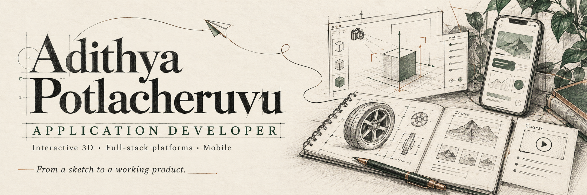

# I build products across 3D, web and mobile.

I’m **Adithya Potlacheruvu**, an **Application Developer at Position²**, based in Bengaluru, India. I work across interactive product visualisation, connected-care applications and learning platforms, connecting the interface people use with the services behind it.

My first professional role began in **April 2025**. Since then, I’ve progressed from Trainee Web Developer through Web Developer and Junior Application Developer to my current role.

[LinkedIn](https://www.linkedin.com/in/adithya-potlacheruvu/) · [Email](mailto:adithyapotlacheruvu@gmail.com)

## Selected work

These are products I have contributed to. The descriptions focus on my work within each project.

| Project | The product | My contribution |
| --- | --- | --- |
| **StudioX** | Interactive 3D product visualisation and rendering workflows | Product-viewer configuration, repeatable camera captures, feature access and supporting platform workflows. |
| **Centered Health for Women** | Connected member and care-team experiences across web and mobile | Work across web portals, backend services and the mobile app, including health-data trends, resource access, registration and check-in presentation. |
| **Samba Academy** | A learning and partner platform | Lesson-document preview/download, HTTP range delivery, progress logic, quiz validation and role-based content visibility. |
| **Roadgrip** | An automotive pitch/concept exploring scroll-led 3D storytelling | Vehicle filtering, wheel configuration, camera/control refinements and loading presentation. A concept presentation, with no implied brand endorsement. |

Some product source code is private. This profile describes contributions without exposing client repositories or user data.

## My working toolkit

- **Interfaces:** JavaScript, TypeScript, React, Next.js, HTML and CSS
- **Interactive 3D:** Three.js, React Three Fiber and WebGL
- **Services:** Node.js, Express and API integration
- **Mobile:** React Native
- **Delivery:** Git, Vite and Vercel

## What I care about

- Making complex product workflows understandable and usable.
- Keeping interface state and backend behaviour consistent.
- Making loading, errors, access and recovery part of the experience.
- Giving motion a purpose, with readable and accessible alternatives.

## Currently building

An interactive, hand-drawn portfolio: scroll to walk, click to explore, and discover the engineering behind each project. The portfolio is in progress for **adithyapotlacheruvu.com**.

## Let’s talk

For product-engineering opportunities and thoughtful collaborations, reach me at **[adithyapotlacheruvu@gmail.com](mailto:adithyapotlacheruvu@gmail.com)** or connect on **[LinkedIn](https://www.linkedin.com/in/adithya-potlacheruvu/)**.
